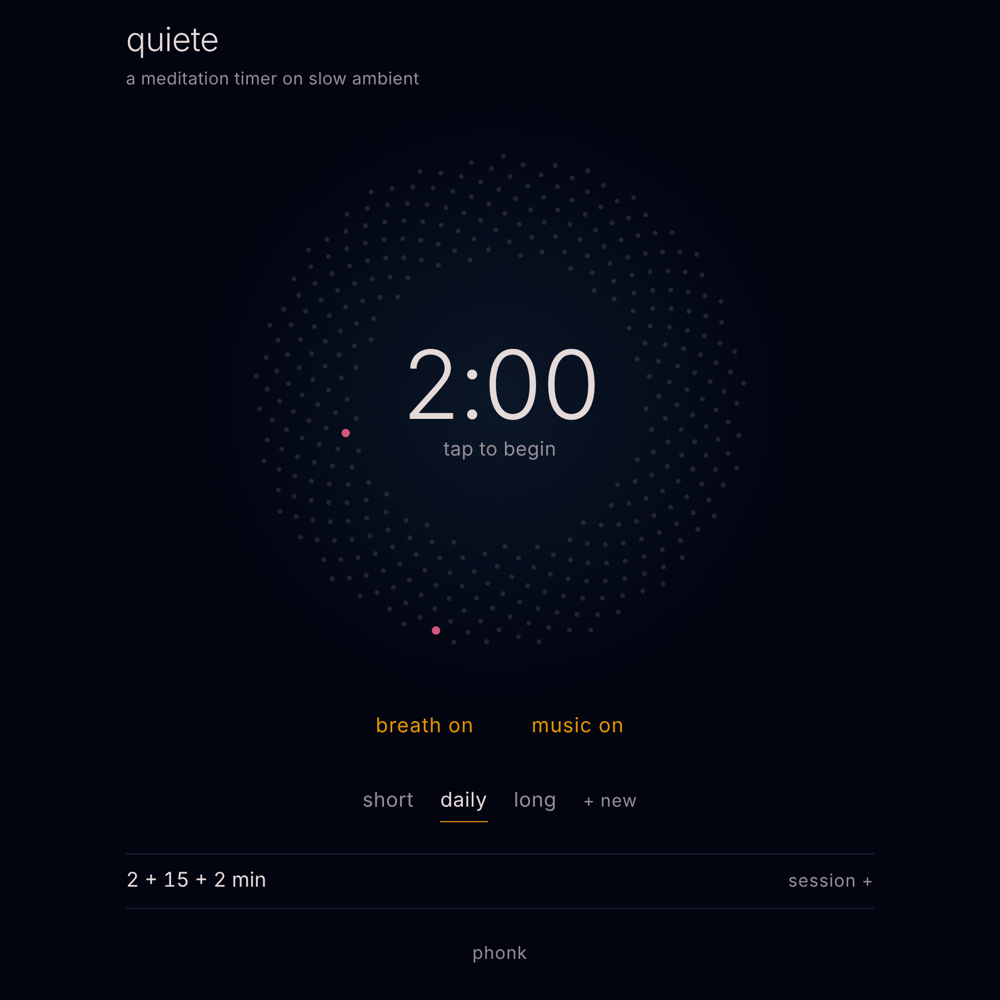

# quiete

*a meditation timer on slow generative ambient*

A three-phase meditation timer — settling in, meditation, coming back — set against a soft generative ambient piece that is never the same twice. One HTML file, no samples, no dependencies, no install.

**▶ Play it: [phonk.github.io/quiete](https://phonk.github.io/quiete/)**

## Play

Tap the circle to start. Tap again to pause, and again to carry on. When a session ends, one more tap takes you back to the start.

Two switches sit under the circle:

- **breath on/off** — the breathing guide, see below.
- **music on/off** — for a silent sit with only the bells.

## What you see

The circle is a seed head of dots, placed on a golden-angle spiral. While you meditate it breathes with you: it opens slowly on the in‑breath and closes on the out‑breath, about five and a half breaths a minute, roughly the pace that research on slow breathing associates with calm. For the first few breaths the phase label spells it out — *breathe in*, *breathe out* — after that the shape alone carries it.

Time runs from the rim of the seed head inward, as a soft lit front rather than a hard edge, so dots never flick on in isolation. A bell's moment is marked in amber on the ring where it will ring; the phase changes — into the meditation, and into coming back — are marked in pink.

Left untouched for a few seconds while a session runs, the rest of the interface fades away and only the breathing shape and the time remain. Any touch brings it back.

## The music

Underneath, a soft ambient piece drifts on its own: slow pad chords, a low drone, far wind. It pulls back and softens during the meditation phase itself, so it never gets in the way, and comes back up a little while you settle in and come back. Turn it off entirely with the music switch and keep only the bells.

## Presets

Sessions are named and saved — "short", "daily", "long" to start. Each preset keeps its own phase lengths, its own bells, and its own music/breath switches. Tap **+ new** to save the session on screen as a preset of its own, rename it in place, or delete it (one tap arms the delete, a second confirms it). Up to eight presets, kept in this browser.

## Setup

Open the **session** panel to change a preset's three phase lengths, add a bell at a fixed point in the meditation or at a regular interval, and preview how the bell sounds.

## Notes

- Like [nebbia](https://phonk.github.io/nebbia/) and [onde](https://phonk.github.io/onde/), it keeps playing with the phone screen off, and you can pause it from the lock screen.
- There is no strong evidence that particular frequencies "heal" or calm the brain on their own. What the research does support is slow, soft, predictable sound and a slow breathing pace — both of which quiete is built around.
